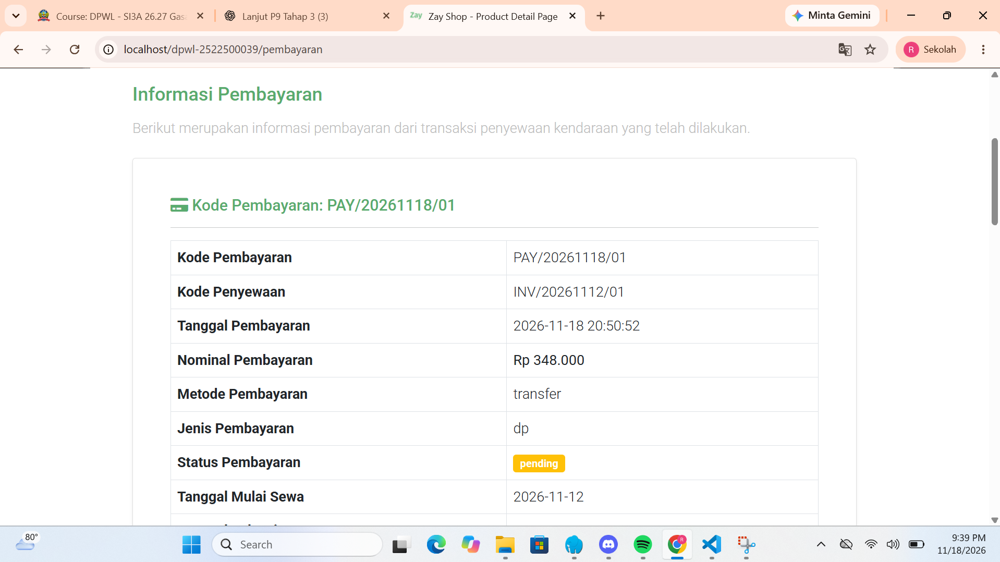
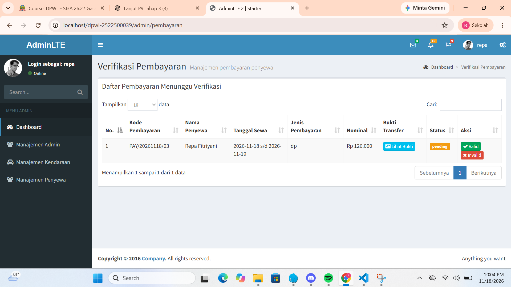
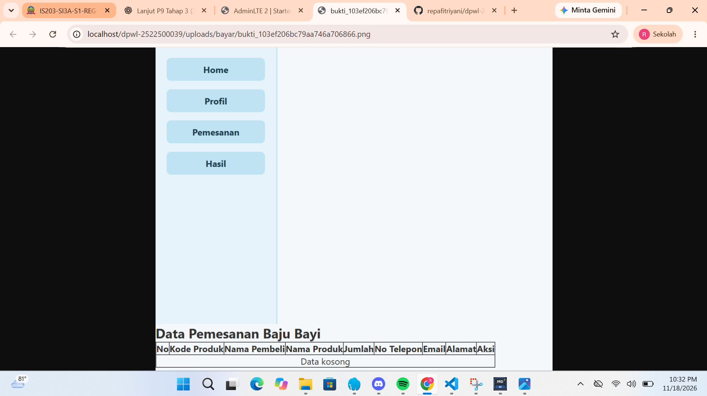
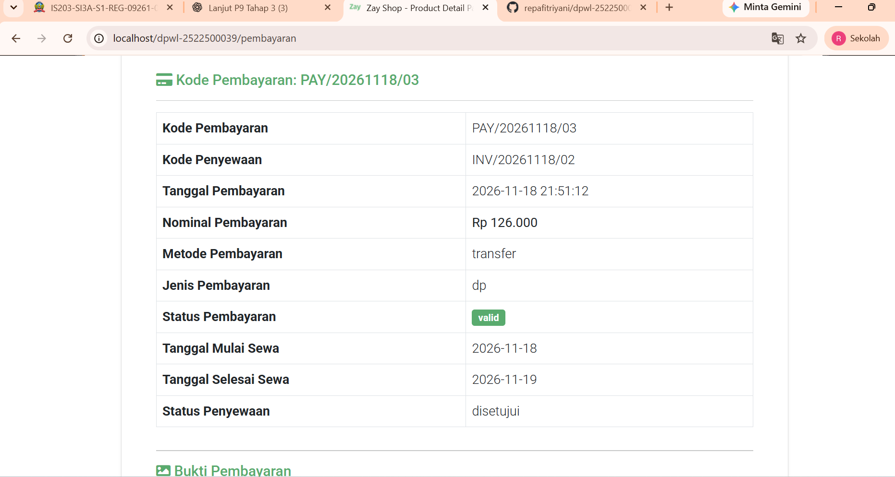
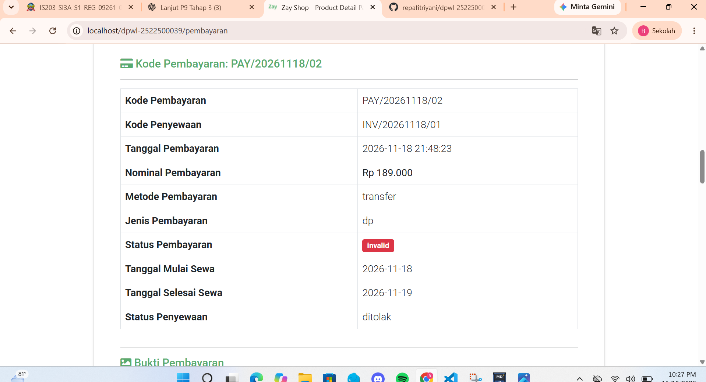

# pertemuan-09

1. menambahakan file pembayaran_model.php

tujuannya : untuk mengatur seluruh proses yang berhubungan dengan data pembayaran penyewaan kendaraan pada database

2. menambahkan file pembayaran_controller.php 

tujuannya : mengatur proses pembayaran yang dilakukan oleh penyewa

# P9 - Pengembangan Sistem Pembayaran

## Dokumentasi P9

### Gambar 1

### Gambar 2

### Gambar 3

### Gambar 4

### Gambar 5

